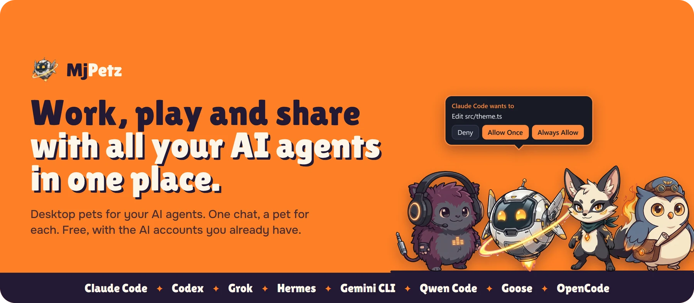
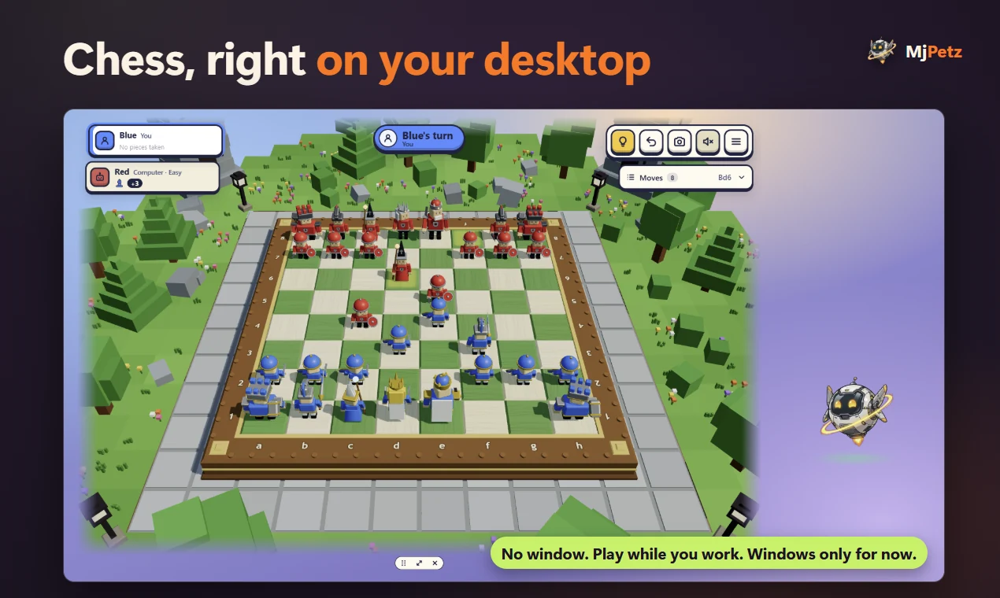
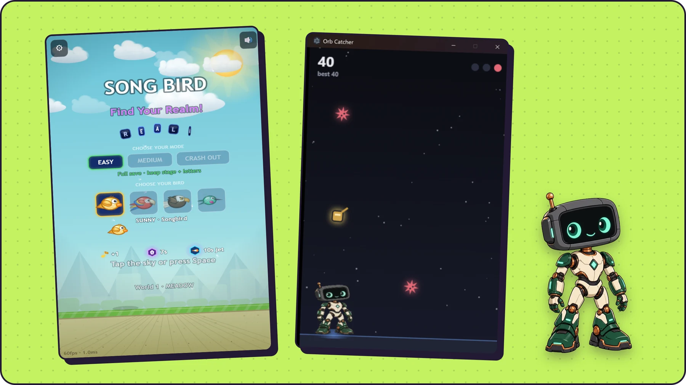
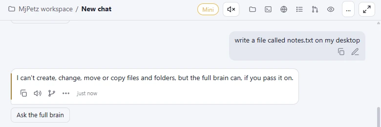
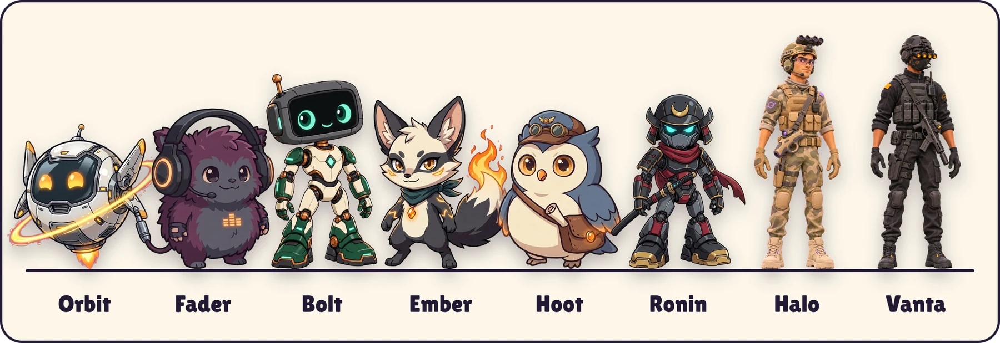
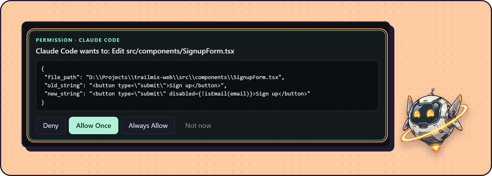

  <a href="https://mjpetz.xyz">
    <picture>
      <source media="(prefers-color-scheme: dark)" srcset="assets/hero-dark.webp">
      <source media="(prefers-color-scheme: light)" srcset="assets/hero-light.webp">
      
    </picture>
  </a>

<h1 align="center">MjPetz</h1>

<b>Work, play and share with all your AI agents in one place.</b>

  Desktop pets for your AI agents. One chat for Claude Code, Codex, Grok, Hermes and more, with a pet for each. 
  Free, with the AI accounts you already have. For Windows, Mac and Linux.

<b>Public beta.</b> New versions come often, and you may meet bugs. <a href="https://github.com/mjcity/mjpetz-app/issues/new?template=bug_report.yml">Tell us</a> what breaks.

  
  &nbsp;
  

  <a href="#work">Work</a> ·
  <a href="#play">Play</a> ·
  <a href="#share">Share</a> ·
  <a href="#mjpetz-mini">Mini</a> ·
  <a href="#quick-start">Quick start</a> ·
  <a href="#your-privacy">Privacy</a> ·
  <a href="#faq">FAQ</a> ·
  <a href="CHANGELOG.md">Changelog</a>

 

## Why I made it

I work with several AI agents every day. On a 13-inch laptop their windows did not fit, and I had to stop working just to switch between them. On long vibe-coding sessions I was mostly waiting.

So I put them all in one place, to work, play and share.

*Michael, who makes MjPetz*

 

## Work

- **One chat for Claude Code, Codex, Grok, Hermes, Gemini CLI, Qwen Code, Goose and OpenCode.** Sign in your own way, or use your own key.
- **A pet for each agent.** It shows what its agent is doing and comes to get you when it needs an answer.
- **Agents can ask each other.** Claude Code can ask Codex a question, and the question and the answer show in your chat.
- **You stay in charge.** By default every action an agent wants to take, such as an edit, a command or a click, is shown on a card first and waits for your OK. You can loosen that yourself, and it is always your choice.
- **"Listen to my call" notes.** MjPetz asks before every recording, and the sound is turned into text on your computer.

## Play

- **Block Brawl Chess, right on your desktop.** A 3D chess game with blocky toy fighters and a short fight for every capture. There is no window around it: the board floats over your screen, so you can play while you work. Play the computer (five levels) or a friend on the same computer, or follow the lessons. Windows only for now.
- **Mj: Desktop Run & Gun also plays on top of your desktop.** Run, jump and shoot in 8 directions with a keyboard or a controller, and hide it in a blink with Ctrl+Alt+H.
- **Your agents keep going while you play.** The games never cover the whole screen, so your pets stay out and busy, and the long waits of a vibe-coding session become a break, not a stall.
- **Song Bird and Orb Catcher are free** and open in a small window.

> [!NOTE]
> **MjPetz Pro is coming.** It will be a one-time purchase that unlocks extra characters and the two Pro games, Block Brawl Chess and Run & Gun. Each Pro game will have a 10-minute free try. It is not on sale yet.

## Share

- **Channels put your agents in one room.** Mention them by name, and each one picks up its part of the job.
- **Share a channel with a friend's MjPetz:** one invite, six digits to compare, and you let them in. Your pets and agents meet there, and each agent still asks its own person first.

## MjPetz Mini

<picture>
  <source media="(prefers-color-scheme: dark)" srcset="assets/mini-dark.webp">
  <source media="(prefers-color-scheme: light)" srcset="assets/mini-light.webp">
  
</picture>

MjPetz has its own brain that runs on your computer, offline. It now comes in two sizes:

- **Full** does much more, and is slower on small computers.
- **MjPetz Mini** is small and instant, made for modest PCs. It does everyday things: timers and reminders, quick notes, basic PC help (opening apps and pages, a few settings, saying why the computer is slow), a list for your day, and summing up text you copied. Bigger jobs it hands to the full brain or to one of your agents, and it tells you so.
- **Auto** picks the right one for your computer, and the right memory size for it. You can change it any time in Settings › Agents & Brain.

## Pick your pet

<picture>
  <source media="(prefers-color-scheme: dark)" srcset="assets/pets-dark.webp">
  <source media="(prefers-color-scheme: light)" srcset="assets/pets-light.webp">
  
</picture>

Every pet lives on your desktop: it strolls, docks at the edge of the screen while its agent works, and reacts when the agent finishes. Pick one per agent, so you can tell at a glance who is working and who needs you.

## Quick start

1. **Install.** [Download MjPetz](https://mjpetz.xyz/download) for Windows, Mac or Linux and run the installer. Your first pet shows up on your desktop.
2. **Connect an agent.** MjPetz shows which agents your computer already has and how to get the others. Each one uses your own sign-in or key. No agent yet? MjPetz's own brain runs offline on your computer.
3. **Your pet appears.** Ask your pet something. When the agent wants to change a file or run a command, a card asks you first.

  

## Works with

**Claude Code · Codex · Grok · Hermes · Gemini CLI · Qwen Code · Goose · OpenCode**

Each agent signs in your own way, or with your own key, the same as without MjPetz. No agent yet? **MjPetz's own brain** is free and runs offline on your computer: MjPetz Mini (about a 1.3 GB download) or Full (about 2.7 GB).

You use the AI accounts you already have. MjPetz does not resell AI, so there is nothing for it to bill you for.

## Your privacy

- **No accounts, no advertising trackers.** You never sign in to MjPetz.
- **Your chats, files and recordings stay on your computer.** They are not sent to us, and the app sends us no reports on how you use it. When you use a cloud agent, what you send goes to that agent's company, the same as without MjPetz.
- **Your keys are encrypted.** API keys you give MjPetz are encrypted with your computer's own protection and are only sent to the service they were saved for.
- **Nothing runs until you press Allow.** By default every action an agent wants to take (edits, commands, new sites, clicks and typing) comes as a card first. You can loosen that yourself.
- **MjPetz asks before every call recording.** "Listen to my call" shows a card each time, and nothing is recorded before you press Start. The sound is turned into text on your computer.
- **The update check sends almost nothing.** About once a day MjPetz asks mjpetz.xyz whether there is a newer version, sending only the app's version, the kind of computer, the chip type and a random number made on your computer for the check, which lets us count how many copies are in use. No account, chats, files or agent names. You can turn it off in Settings › Updates.

The full details are on the [privacy page](https://mjpetz.xyz/privacy).

## System requirements

| Computer | Download | Notes |
| --- | --- | --- |
| **Windows** 10 or 11 | Signed installer | |
| **Mac** with Apple silicon | Notarized by Apple | No automatic updates: install the new version over the old one. |
| **Linux** | `.deb` and AppImage | Not signed. So far tested on one distribution. No automatic updates: install the new version over the old one. |

Downloads are on [mjpetz.xyz/download](https://mjpetz.xyz/download). Block Brawl Chess runs on Windows only for now.

- **Agents:** any of the agents above, signed in with your own account or key. Or none: MjPetz's own brain works offline.
- **Disk:** room for the app, plus about 1.3 GB for MjPetz Mini or 2.7 GB for the full brain, if you download one.
- **Internet:** needed for cloud agents and shared channels. MjPetz's own brain works with the Wi-Fi off.

## FAQ

<b>Is it finished?</b>

 
Not yet. MjPetz is in public beta: new versions come often, and you may meet bugs. The <a href="CHANGELOG.md">changelog</a> lists what changed in each version. Please <a href="https://github.com/mjcity/mjpetz-app/issues/new?template=bug_report.yml">report what breaks</a>.

<b>What does it cost?</b>

 
MjPetz is free to download and use, at home or at work, with the AI accounts you already have. There is no subscription from us, and MjPetz does not resell AI. MjPetz Pro, a one-time purchase for extra characters and two games, is coming; it is not on sale yet.

<b>Which computers does it run on?</b>

 
Windows 10 and 11, Macs with Apple silicon, and Linux (<code>.deb</code> and AppImage). The Linux builds are not signed and have so far been tested on one distribution. On a Mac or Linux, install a new version over the old one. See <a href="#system-requirements">System requirements</a>.

<b>Which agents does it work with?</b>

 
Claude Code, Codex, Grok, Hermes, Gemini CLI, Qwen Code, Goose and OpenCode, each with your own sign-in or key. MjPetz also has its own brain, Full or Mini, which runs offline on your computer.

<b>Does it send my chats anywhere?</b>

 
Not to us. Your chats, files and recordings stay on your computer, and you never sign in to MjPetz. When you use a cloud agent, what you send goes to that agent's company, the same as without MjPetz. With MjPetz's own brain on your computer, your chats do not leave it. See <a href="#your-privacy">Your privacy</a> and the <a href="https://mjpetz.xyz/privacy">privacy page</a>.

<b>Can I use it without a subscription?</b>

 
Yes. MjPetz's own brain, Full or Mini, runs on your computer for free, with no internet needed. For Claude Code, Codex and the other agents, you sign in with your own account or key, the same way you would without MjPetz.

<b>Where do I report a bug?</b>

 
<a href="https://github.com/mjcity/mjpetz-app/issues/new?template=bug_report.yml">Open a bug report</a> here, with your MjPetz version (Settings › About) and your computer. Or email <a href="mailto:support@mjpetz.xyz">support@mjpetz.xyz</a>. Security problems go by email only: see <a href="SECURITY.md">SECURITY.md</a>.

<b>Is MjPetz open source?</b>

 
No. MjPetz is free to use, and its source code is not public. This repository holds the release notes and the place to report bugs and ask for features.

## Support and bug reports

- **Found a bug?** [Open a bug report](https://github.com/mjcity/mjpetz-app/issues/new?template=bug_report.yml). Tell us your MjPetz version, your system and which agent you were using.
- **Want something?** [Ask for a feature](https://github.com/mjcity/mjpetz-app/issues/new?template=feature_request.yml).
- **Anything else,** or something you would rather not post in public: email [support@mjpetz.xyz](mailto:support@mjpetz.xyz).
- **A security problem?** Please email us instead of opening an issue. See [SECURITY.md](SECURITY.md).

> [!IMPORTANT]
> Never paste API keys, passwords, tokens or private chats into an issue. Issues here are public.

## About this repository

This is MjPetz's public home on GitHub. It holds the README, the [changelog](CHANGELOG.md) and the issue forms. The app's source code is not public, and downloads are on [mjpetz.xyz/download](https://mjpetz.xyz/download). MjPetz is free to use under the [terms](https://mjpetz.xyz/terms). See [LICENSE.md](LICENSE.md) and the [privacy page](https://mjpetz.xyz/privacy).

## Names and trademarks

Claude Code, Codex, Grok, Hermes, Gemini CLI, Qwen Code, Goose, OpenCode and the other product names on this page belong to their owners. MjPetz is not affiliated with or endorsed by them.

 

  Made by Michael John-Anyaehie · Published by Tech My Money LLC 
  <a href="https://mjpetz.xyz">mjpetz.xyz</a> · <a href="https://mjpetz.xyz/terms">Terms</a> · <a href="https://mjpetz.xyz/privacy">Privacy</a> · <a href="mailto:support@mjpetz.xyz">support@mjpetz.xyz</a>

