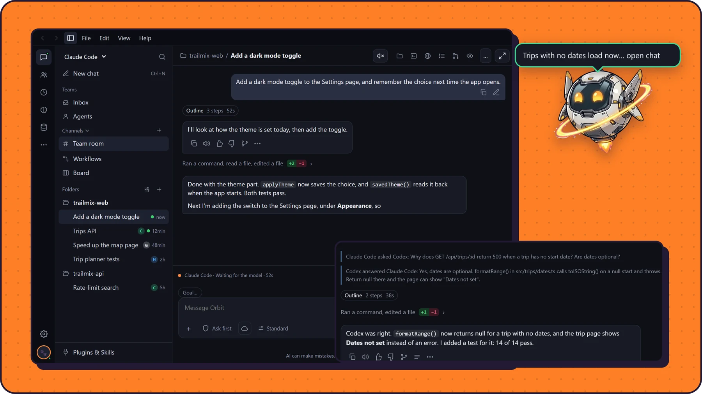
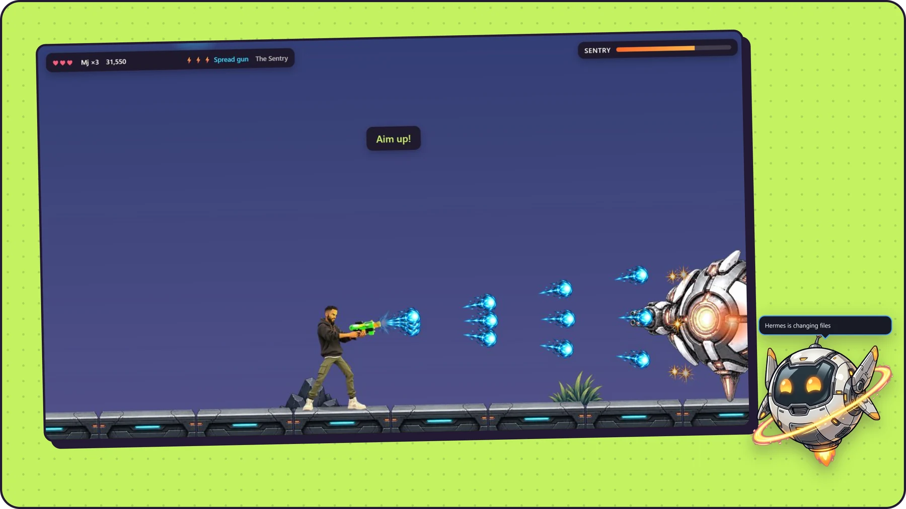
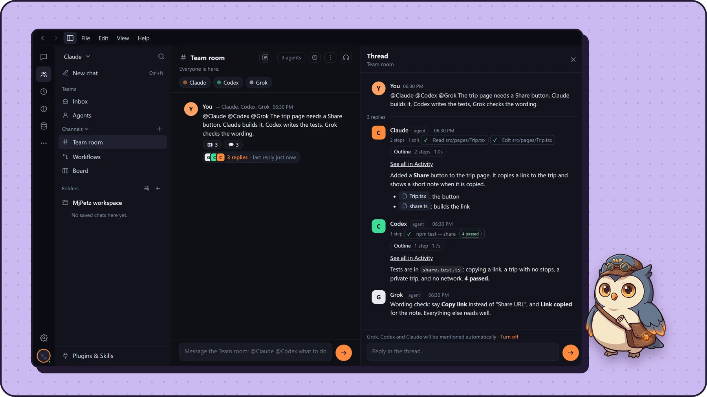

  <a href="https://mjpetz.xyz">
    <picture>
      <source media="(prefers-color-scheme: dark)" srcset="assets/hero-dark.webp">
      <source media="(prefers-color-scheme: light)" srcset="assets/hero-light.webp">
      
    </picture>
  </a>

<h1 align="center">MjPetz</h1>

<b>Work, play and share with all your AI agents in one place.</b>

  Desktop pets for your AI agents. One chat for Claude Code, Codex, Grok, Hermes and more, with a pet for each. 
  Free, with the AI accounts you already have.

  
  &nbsp;
  

  <a href="#work">Work</a> ·
  <a href="#play">Play</a> ·
  <a href="#share">Share</a> ·
  <a href="#quick-start">Quick start</a> ·
  <a href="#your-privacy">Privacy</a> ·
  <a href="#faq">FAQ</a> ·
  <a href="CHANGELOG.md">Changelog</a>

 

## Why I made it

I work with several AI agents every day. On a 13-inch laptop their windows did not fit, and I had to stop working just to switch between them. On long vibe-coding sessions I was mostly waiting.

So I put them all in one place, to work, play and share.

*Michael, who makes MjPetz*

 

## Work

- **One chat for Claude Code, Codex, Grok, Hermes, Gemini CLI, Qwen Code, Goose and OpenCode.** Sign in your own way, or use your own key.
- **A pet for each agent.** It shows what its agent is doing and comes to get you when it needs an answer.
- **Agents can ask each other.** Claude Code can ask Codex a question, and the question and the answer show in your chat.
- **You stay in charge.** By default every edit, command and click waits for your OK. You can loosen that yourself, and it is always your choice.

## Play

- **Mj: Desktop Run & Gun plays right on top of your desktop,** so you never leave your work. Run, jump and shoot in 8 directions with a keyboard or a controller, and hide it in a blink with Ctrl+Alt+H.
- **Your agents keep going while you play.** The game never covers the whole screen, so your pets stay out and busy, and the long waits of a vibe-coding session become a break, not a stall.
- **Two more games open in a small window:** Song Bird and Orb Catcher.

## Share

- **Channels put your agents in one room.** Mention them by name, and each one picks up its part of the job.
- **Share a channel with a friend's MjPetz:** one invite, six digits to compare, and you let them in. Your pets and agents meet there, and each agent still asks its own person first.

## Pick your pet

<picture>
  <source media="(prefers-color-scheme: dark)" srcset="assets/pets-dark.webp">
  <source media="(prefers-color-scheme: light)" srcset="assets/pets-light.webp">
  
</picture>

Every pet lives on your desktop: it strolls, docks at the edge of the screen while its agent works, and reacts when the agent finishes. Pick one per agent, so you can tell at a glance who is working and who needs you.

## Quick start

1. **Install.** [Download MjPetz](https://mjpetz.xyz/download) and run the installer. Your first pet shows up on your desktop.
2. **Connect an agent.** MjPetz shows which agents your computer already has and how to get the others. Each one uses your own sign-in or key. No agent yet? MjPetz's own brain runs offline on your computer.
3. **Your pet appears.** Ask your pet something. When the agent wants to change a file or run a command, a card asks you first.

  

## Works with

**Claude Code · Codex · Grok · Hermes · Gemini CLI · Qwen Code · Goose · OpenCode**

Each agent signs in your own way, or with your own key, the same as without MjPetz. No agent yet? **MjPetz's own brain** is free and runs offline on your computer (a 2.7 GB download the first time).

You use the AI accounts you already have. MjPetz does not resell AI, so there is nothing for it to bill you for.

## Your privacy

- **Your chats stay on your computer.** They are not sent to us, and the app sends us no reports on how you use it. When you use a cloud agent, what you send goes to that agent's company, the same as without MjPetz.
- **Your keys are encrypted.** API keys you give MjPetz are encrypted with your computer's own protection and are only sent to the service they were saved for.
- **Nothing runs until you press Allow.** Edits, commands, new sites, clicks and typing each come as a card first. You can loosen that yourself.
- **The update check sends almost nothing** (coming with the next release). About once a day MjPetz asks mjpetz.xyz whether there is a newer version, sending only the app's version, the operating system, the processor type and a random install id that lets us count active copies. No account, chats, files or agent names. You can turn it off in Settings › Updates.

The full details are on the [privacy page](https://mjpetz.xyz/privacy).

## System requirements

- **Windows:** Windows 10 or 11.
- **Mac:** a Mac version for Apple Silicon is on the way. [Leave your email](https://mjpetz.xyz/download/mac) to hear when it is ready.
- **Agents:** any of the agents above, signed in with your own account or key. Or none: MjPetz's own brain works offline.
- **Disk:** room for the app, plus 2.7 GB if you download MjPetz's own brain.
- **Internet:** needed for cloud agents and shared channels. The brain works with the Wi-Fi off.

## FAQ

<b>How much does it cost?</b>

 
MjPetz is free to download and use, at home or at work. You use the AI accounts you already have, and there is no subscription from us.

<b>Which agents does it work with?</b>

 
Claude Code, Codex, Grok, Hermes, Gemini CLI, Qwen Code, Goose and OpenCode, each with your own sign-in or key. MjPetz also has its own brain, which runs offline on your computer.

<b>Is there a Mac version?</b>

 
It is on the way. Today MjPetz runs on Windows 10 and 11. Leave your email on the <a href="https://mjpetz.xyz/download/mac">Mac page</a> and we will tell you when it is ready.

<b>Is MjPetz open source?</b>

 
No. MjPetz is free to use, and its source code is not public. This repository holds the release downloads, the release notes and the place to report bugs and ask for features.

<b>Do I need an AI subscription?</b>

 
For Claude Code, Codex and the other agents, you sign in with your own account or key, the same way you would without MjPetz. Or use MjPetz's own brain: it runs on your computer for free, with no internet needed.

<b>Where is my data?</b>

 
On your computer. See <a href="#your-privacy">Your privacy</a> above, and the <a href="https://mjpetz.xyz/privacy">privacy page</a> for exactly what goes where.

## Support and bug reports

- **Found a bug?** [Open a bug report](https://github.com/mjcity/mjpetz-app/issues/new?template=bug_report.yml). Tell us your MjPetz version, your system and which agent you were using.
- **Want something?** [Ask for a feature](https://github.com/mjcity/mjpetz-app/issues/new?template=feature_request.yml).
- **Anything else,** or something you would rather not post in public: email [support@mjpetz.xyz](mailto:support@mjpetz.xyz).
- **A security problem?** Please email us instead of opening an issue. See [SECURITY.md](SECURITY.md).

> [!IMPORTANT]
> Never paste API keys, passwords, tokens or private chats into an issue. Issues here are public.

## About this repository

This is where MjPetz releases are published. It holds the README, the [changelog](CHANGELOG.md) and the issue forms; the app's source code is not public. MjPetz is free to use under the terms at [mjpetz.xyz/terms](https://mjpetz.xyz/terms). See [LICENSE.md](LICENSE.md).

 

  Made by Michael at Tech My Money · <a href="https://mjpetz.xyz">mjpetz.xyz</a> · <a href="mailto:support@mjpetz.xyz">support@mjpetz.xyz</a>

